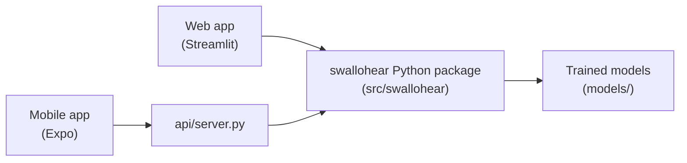

<div align="center">


# SWALLOHear

**A reliability-aware acoustic swallowing analysis research system for post-stroke dysphagia research**

Team **RIPARION** · Philippine Junior Data Science Challenge (PJDSC) 2026<br>
*Trace the Pattern, Target the Cure: Advancing Public Health Through Data Science*

<p>
  
  
  
  
  <a href="https://doi.org/10.5281/zenodo.4539695"></a>
</p>

[Research paper (PDF)](docs/SWALLOHear_Research_Paper.pdf) ·
[Research paper (web)](docs/SWALLOHear_Research_Paper.md) ·
[Web app guide](docs/APP_GUIDE.md) ·
[Mobile app guide](docs/MOBILE_GUIDE.md) ·
[Web demo video](docs/demo.webm) ·
[Mobile walkthrough](docs/mobile-demo/README.md)

</div>

> [!WARNING]
> **Research prototype, not a diagnostic device.** SWALLOHear detects swallowing-related sounds in neck-microphone audio
> and says how far to trust each result. It does **not** assess dysphagia, aspiration or pneumonia and must not be used to
> make care decisions. Do not upload identifiable patient audio to a shared server.


> [!TIP]
> **Fastest way to try it:** run the [web app](#option-a-web-app-on-your-computer) and choose **Demo** in the sidebar.
> The demo clips are included in the repository, so there is no dataset to download.

## At a glance

- **It checks the recording first.** If the audio is too poor to judge, the result is withheld instead of guessed.
- **It shows how far to trust each detection.** Every detected swallow-related sound is labelled **Confident** or **Low-confidence**.
- **It works on the web and on your phone.** The same Python models power a website (Streamlit) and an Android/iPhone app (Expo).
- **Headline result:** reporting only Confident events raises precision from **0.41 to 0.69** and cuts false detections from
  **9.4 to 1.5 per minute**, at the cost of recall (**0.63 to 0.33**). See [What we found](#what-we-found).

## Contents

- [What is SWALLOHear?](#what-is-swallohear)
- [Features](#features)
- [How it works](#how-it-works)
- [Quick start](#quick-start)
- [What we found](#what-we-found)
- [Limitations and ethics](#limitations-and-ethics)
- [Reproduce the experiments](#reproduce-the-experiments)
- [Repository layout](#repository-layout)
- [Troubleshooting](#troubleshooting)
- [Team](#team)
- [Data, licence and citation](#data-licence-and-citation)

---

## What is SWALLOHear?

About **4 in 10 people who have an acute stroke develop dysphagia** (difficulty swallowing), which is linked to about
four times higher odds of pneumonia and of death (Banda et al., 2022). The best tests (videofluoroscopy) need X-ray
equipment and specialists. **Cervical auscultation**, listening to swallowing sounds at the neck with a microphone, is
cheap and non-invasive, but automatic analysis of those sounds usually fails silently: it gives confident-looking answers
on noisy recordings and on people it has never heard before.

SWALLOHear is built around that reliability gap. For every recording it:

1. **checks the recording quality** first, and withholds the result ("Inconclusive") if the audio is too poor to judge;
2. **finds each swallowing-related sound** and gives its start time, end time and duration;
3. **scores how trustworthy each detection is** with a separately trained reliability model, and labels it
   **Confident** or **Low-confidence**, instead of presenting every guess as certain;
4. **explains** each score, measures **swallowing rhythm**, compares against **expert labels** where available, and
   exports everything.

## Features

Every feature below is available in **both the web app and the mobile app**.

### Get audio in

- **Demo clips** from held-out test participants, with expert labels
- **Upload your own audio** (WAV and FLAC on web; plus M4A, MP3 and WebM on mobile)
- **Record** from the microphone
- **Synthetic test signals**

### Read the result

- **Four-state verdict:** Events detected, No event, or Result withheld, with reason codes
- **Interactive timeline:** waveform, spectrogram and detector score; tap or click an event
- **Event card:** listen to the event, see its reliability gauge, top reasons and a zoomed view
- **Your own call** on each event (Swallow, Not swallow or Unsure)
- **"Why this score?":** the exact breakdown of each event's reliability score
- **Rhythm:** rate, intervals, regularity and longest pause

### Check how far to trust it

- **Signal quality:** every quality-gate check, the SNR estimate explained, and the spectrum
- **Robustness lab:** re-run a clip at 7 noise levels and watch the quality gate react
- **Stress test:** add white, pink or 60 Hz mains-hum noise, or simulated clipping
- **Expert comparison:** precision, recall, F1, timing error, and Expert-vs-System lanes
- **Live detector settings:** 5 thresholds you can change, with a reset to the validated values

### Compare, export and customise

- **Compare** two recordings (or one clip clean vs noisy) side by side
- **Batch analysis** of many recordings
- **Method and results page** with the experiment charts
- **Exports:** events CSV, full JSON, annotations, session log, and a printable HTML/PDF report
- **Light and dark mode**

Every feature is explained step by step, with screenshots, in the [research paper](docs/SWALLOHear_Research_Paper.md#7-user-guide),
the [web app guide](docs/APP_GUIDE.md) and the [mobile app guide](docs/MOBILE_GUIDE.md).

### Watch the mobile app

The [mobile walkthrough](docs/mobile-demo/README.md) shows the features one by one in an iPhone-sized frame, with a
finger indicator for every tap: a full video, a short clip per feature, and snapshots.

<div align="center">
  <a href="docs/mobile-demo/README.md">
    
  </a>
</div>

## How it works


1. **Audio in.** Any sample rate is converted to 4 kHz mono, the rate of the research dataset.
2. **Quality gate.** The app estimates the signal-to-noise ratio (SNR) from the recording itself and checks for clipping,
   dropouts, too-low bandwidth and length (1–120 s). If any check fails, the result is **withheld** rather than guessed.
3. **Detector.** A Random Forest, trained with added noise, scores every 16 ms step of the audio for how swallow-like it
   sounds, using 81 acoustic features.
4. **Events.** A score above 0.70 starts an event, it continues while the score stays above 0.65, and events less than
   0.4 s apart are merged.
5. **Reliability.** A second, separately trained model looks at seven measurements of each event (how high the score
   peaked, how long it lasted, how loud it was, …) and gives a **reliability score**. Events at or above 0.50 are
   **Confident**; the rest are **Low-confidence**.

All thresholds were chosen on validation participants only. The 27 test participants were used once, for reporting.

**How the pieces connect.** The web app and the mobile app both use the same `swallohear` Python package and trained
models. The web app calls the package directly; the mobile app talks to it through a small HTTP server (`api/server.py`).



---

## Quick start

### Choose your path

| I want to… | I need | Go to |
|---|---|---|
| Try it on my computer (easiest) | Python 3.13 | [Option A: Web app](#option-a-web-app-on-your-computer) |
| Use it on my phone | Python 3.13, Node.js, Expo Go | [Option B: Mobile app](#option-b-mobile-app-on-your-phone) |
| Try the mobile app without a phone | Python 3.13, Node.js | [Mobile app in a browser](#no-phone-use-the-mobile-app-in-your-browser) |
| Just look, without installing anything | A browser | [Web demo video](docs/demo.webm) or [mobile walkthrough](docs/mobile-demo/README.md) |
| Reproduce the paper's numbers | Python 3.13, the Zenodo data | [Reproduce the experiments](#reproduce-the-experiments) |

### What you need

- **Windows, macOS or Linux**, with **Python 3.13** ([python.org](https://www.python.org/downloads/), or `py install 3.13` on Windows).
- **Node.js 22 or 24 LTS**, only for the mobile app ([nodejs.org](https://nodejs.org)).
- **Expo Go** on your phone, only for the mobile app (App Store or Google Play).
- About 1 GB of free disk space.

### One-time setup

Open a terminal (on Windows, *Command Prompt*) and run the commands for your system.

**Windows**

```bat
git clone https://github.com/jedelacruz/swallohear.git
cd swallohear
py -3.13 -m venv .venv
.venv\Scripts\activate
pip install -r requirements.txt
python -m pytest -q
```

**macOS and Linux**

```bash
git clone https://github.com/jedelacruz/swallohear.git
cd swallohear
python3.13 -m venv .venv
source .venv/bin/activate
pip install -r requirements.txt
python -m pytest -q
```

After the `activate` step your prompt starts with `(.venv)`. The last command runs the tests: **8 tests should pass in
about 10 seconds**, which confirms everything is installed correctly.

> [!NOTE]
> Every time you open a new terminal, go to the `swallohear` folder and activate the environment again
> (`.venv\Scripts\activate` on Windows, `source .venv/bin/activate` on macOS and Linux).

### Option A: Web app on your computer

```bash
streamlit run app/streamlit_app.py
```

Your browser opens at **http://localhost:8501**. Choose **Demo** in the sidebar and pick a clip. Press **Ctrl+C** in the
terminal to stop. Other devices on your Wi-Fi can open the *Network URL* that the terminal prints.

### Option B: Mobile app on your phone

The phone app sends audio to a small analysis server on your computer, through the same Expo connection that loads the
app, so there is no server address to set up. The phone and the computer must be able to reach each other: the same
Wi-Fi, or a hotspot from either device.

**Terminal 1: analysis server** (environment active, in the `swallohear` folder)

```bash
python api/server.py
```

**Terminal 2: the app**

```bash
cd mobile
npm install
npx expo start
```

Scan the QR code: on **Android** with the Expo Go app, on **iPhone** with the Camera app. If Windows asks whether
Node.js may use the network, allow it.

> [!IMPORTANT]
> **iPhone only:** Expo Go needs the same free Expo account on the phone and the computer. Create one at
> [expo.dev/signup](https://expo.dev/signup), sign in inside Expo Go, then run `npx expo login --no-browser` on the
> computer before `npx expo start`.

#### No phone? Use the mobile app in your browser

With the server and `npx expo start` running as above, press **w** in Terminal 2. The mobile app opens in your browser
at **http://localhost:8081**.

#### Running everything at once

You can run the web app, the phone app and the browser version **at the same time**. They use different ports:
8501 (web app), 8000 (analysis server) and 8081 (mobile app in the browser).

---

## What we found

Setup: a single participant-disjoint split; 27 held-out test participants (171 recordings, 288 labelled swallows).
Events count as matched when they overlap a labelled swallow by at least half (IoU ≥ 0.5). 95% confidence intervals come
from a participant-level bootstrap. Full tables and discussion are in the
[research paper](docs/SWALLOHear_Research_Paper.md#5-results).

| Question | Result |
|---|---|
| How well are swallows detected on clean audio? | Energy baseline F1 **0.28** (95% CI 0.23–0.34); Random Forest F1 **0.50** (0.40–0.59). |
| Does it survive noise? | A clean-trained model collapses (F1 0.14 at 20 dB, 0.00 at 10 dB). Training with noise keeps F1 **0.45 / 0.39 / 0.31** at 20 / 10 / 5 dB. |
| Can the detector's own confidence be trusted? | **No.** It separates correct from wrong detections barely better than chance (AUROC **0.53**). The learned reliability score does much better (AUROC **0.79**). |
| Does reliability-aware output help? | Reporting only Confident events raises precision from **0.41 to 0.69** and cuts false detections from **9.4 to 1.5 per minute**, at the cost of recall (**0.63 → 0.33**). |
| Does the quality gate catch bad recordings? | It withholds **2%** of clean recordings, **30%** at 20 dB, **82%** at 10 dB and **94%** at 5 dB, instead of reporting results it cannot trust. |
| Is a neck accelerometer better than the microphone? | Not in this pipeline (F1 0.47 vs 0.49). |
| Is it fast enough? | A 30-second clip is analysed in a median **0.13 s** on a laptop CPU (target: ≤ 5 s). |

## Limitations and ethics

- **Modest accuracy.** Event F1 is about 0.5, far from clinical standard. The reliability-aware output buys precision
  with a large loss of recall: a trade-off, not a free improvement.
- **One dataset, one split.** Results come from one public US dataset and 27 test participants. Nothing has been
  validated on Philippine patients, phones or low-cost stethoscopes.
- **Synthetic noise.** Noise tests use added white noise, not real rooms.
- **Possibly incomplete labels.** Some "false detections" may be real swallows that were never labelled.
- **No stroke-specific claims.** The dataset's `ns`/`s` file groups were never verified, so they are not treated as stroke labels.
- **No CNN.** The proposed compact CNN (M2) was not built; the Random Forest is the final detector.
- **Privacy.** Audio is processed in memory and not stored. Only public, de-identified research data are used.

---

## Reproduce the experiments

The research data are not stored in this repository. Download `signals.zip` and `labels.zip` from
[Zenodo (DOI 10.5281/zenodo.4539695)](https://doi.org/10.5281/zenodo.4539695) into `data/raw/`, then run the steps below
in order. Random seeds are fixed, and steps 3–6 take about 30 minutes on a laptop CPU.

<details>
<summary>Show the 8 steps</summary>

| Step | Command | What it does |
|---|---|---|
| 1 | `python scripts/prepare_data.py --dir data/raw` | Verifies MD5 checksums and unpacks to `data/interim/` |
| 2 | `python scripts/build_index.py` | Sanity checks and the participant-disjoint 70/15/15 split |
| 3 | `python scripts/evaluate_baselines.py` | Energy baseline vs Random Forest (`results/baselines.json`) |
| 4 | `python scripts/run_experiments.py` | Calibration, confidence, noise, sensor ablation; trains `models/rf_mic.joblib` |
| 5 | `python scripts/run_reliability_v2.py` | Noise-augmented RF, learned reliability model, quality gate (`models/*.joblib`, `configs/final.json`) |
| 6 | `python scripts/bootstrap_ci.py` | Participant-level 95% confidence intervals; checks itself against step 5 |
| 7 | `python scripts/make_demo_clips.py` | Demo clips, from test participants only |
| 8 | `python scripts/make_paper.py figures` | Redraws the paper's figures from `results/` |

</details>

## Repository layout

<details>
<summary>Show the folder guide</summary>

| Path | What it is |
|---|---|
| `src/swallohear/` | The core Python package: audio loading, preprocessing, features, detectors, quality gate, reliability model (`final.py`) |
| `app/streamlit_app.py`, `app/views/` | The web app (Analyze, Compare, Batch, Method & results pages) |
| `api/server.py` | HTTP API used by the mobile app |
| `mobile/` | The Expo / React Native mobile app |
| `models/` | Trained models (noise-augmented Random Forest, reliability model) |
| `configs/final.json` | Thresholds selected on validation participants |
| `results/` | Experiment outputs (JSON) that every reported number comes from |
| `data/demo/` | Seven demo clips from held-out test participants (CC BY 4.0) |
| `scripts/` | Data preparation, experiments, demo clips, documentation figures and screenshots |
| `tests/` | Unit tests (`test_core.py`) and the API smoke test (`test_api.py`) |
| `docs/` | Research paper, web and mobile guides, screenshots, demo GIF and video |

</details>

## Troubleshooting

<details>
<summary>Show common problems and fixes</summary>

| Problem | Fix |
|---|---|
| `DLL load failed … An Application Control policy has blocked this file` | Windows Smart App Control is blocking a very new package. Use Python 3.13 and `pip install -r requirements.txt` (it pins versions that load). |
| `'streamlit'` or `'python'` is not recognized | Go to the `swallohear` folder and activate the environment first (`.venv\Scripts\activate` on Windows). |
| `AttributeError: 'Analyzer' object has no attribute 'score'` | The server was started before you updated the code. Stop it with Ctrl+C and start it again. |
| Phone app: "Can't reach the analysis server" | Make sure `python api/server.py` is running on the same computer as `npx expo start`, then reload the app. In Settings (gear icon) → Analysis server, choose **Automatic**. |
| Expo Go: "The request timed out" | The phone can't reach the computer. Restart `npx expo start` after changing Wi-Fi and scan the **new** QR code. Some routers and phone hotspots block devices from talking to each other: use the computer's own Mobile Hotspot, or your iPhone's Personal Hotspot with the computer joined to it. |
| iPhone: "You need to be signed in to Expo Go and Expo CLI" | Sign in to the same Expo account in Expo Go and with `npx expo login --no-browser` on the computer. |
| Blank page after restarting a server | Reload the browser tab. |

</details>

---

## Team

**Team RIPARION**

- Jan Emmanuel Dela Cruz
- Denver Reyes
- Joshua Abalo
- Rhaine Cyrel Valera
- Jhayciel Santiago

## Data, licence and citation

**Data:** Khalifa, Y., Donohue, C., Coyle, J., & Sejdić, E. (2021). *Swallowing High Resolution Cervical Auscultation
Signals* [Data set]. Zenodo. https://doi.org/10.5281/zenodo.4539695 (CC BY 4.0). The demo clips in `data/demo/` are
excerpts of this dataset under the same licence.

**Code:** see [LICENSE](LICENSE).

**Cite this work:** Dela Cruz, J. E., Reyes, D., Abalo, J., Valera, R. C., & Santiago, J. (2026). *SWALLOHear: A
reliability-aware acoustic swallowing analysis research system for post-stroke dysphagia* (Team RIPARION, PJDSC 2026).
https://github.com/jedelacruz/swallohear

<details>
<summary>BibTeX</summary>

```bibtex
@misc{swallohear2026,
  title  = {SWALLOHear: A reliability-aware acoustic swallowing analysis research system for post-stroke dysphagia},
  author = {Dela Cruz, Jan Emmanuel and Reyes, Denver and Abalo, Joshua and Valera, Rhaine Cyrel and Santiago, Jhayciel},
  year   = {2026},
  note   = {Team RIPARION, Philippine Junior Data Science Challenge (PJDSC) 2026},
  url    = {https://github.com/jedelacruz/swallohear}
}
```

</details>
