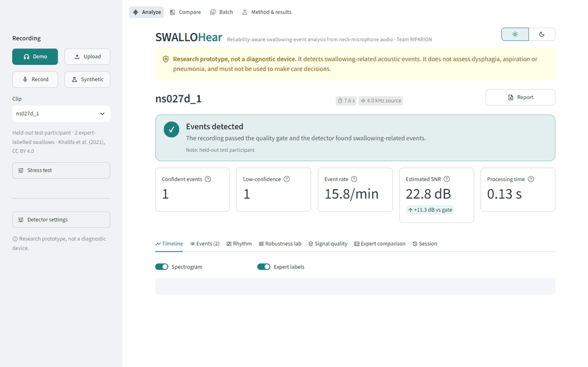
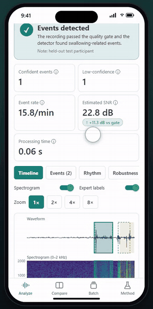

<div align="center">


# SWALLOHear

**A reliability-aware acoustic swallowing analysis research system for post-stroke dysphagia research**

Team **RIPARION** · Philippine Junior Data Science Challenge (PJDSC) 2026<br>
*Trace the Pattern, Target the Cure: Advancing Public Health Through Data Science*

[Research paper (PDF)](docs/SWALLOHear_Research_Paper.pdf) · [Paper (web)](docs/SWALLOHear_Research_Paper.md) ·
[Web app guide](docs/APP_GUIDE.md) · [Mobile app guide](docs/MOBILE_GUIDE.md) · [Web demo](docs/demo.webm) ·
[Mobile walkthrough](docs/mobile-demo/README.md)

</div>

> [!WARNING]
> **Research prototype, not a diagnostic device.** SWALLOHear detects swallowing-related sounds in neck-microphone audio
> and says how far to trust each result. It does **not** assess dysphagia, aspiration or pneumonia and must not be used to
> make care decisions. Do not upload identifiable patient audio to a shared server.



---

## Contents

- [What is SWALLOHear?](#what-is-swallohear)
- [Team](#team)
- [Features](#features)
- [How it works](#how-it-works)
- [Quick start](#quick-start)
- [Using the web app](#1-web-app-on-your-computer)
- [Using the mobile app](#2-mobile-app-on-your-phone-android--iphone)
- [What we found](#what-we-found)
- [Reproduce the experiments](#reproduce-the-experiments)
- [Repository layout](#repository-layout)
- [Troubleshooting](#troubleshooting)
- [Limitations and ethics](#limitations-and-ethics)
- [Data, licence and citation](#data-licence-and-citation)

---

## What is SWALLOHear?

About **4 in 10 people who have an acute stroke develop dysphagia** (difficulty swallowing), which is linked to about
four times higher odds of pneumonia and of death (Banda et al., 2022). The best tests (videofluoroscopy) need X-ray
equipment and specialists. **Cervical auscultation**, listening to swallowing sounds at the neck with a microphone, is
cheap and non-invasive, but automatic analysis of those sounds usually fails silently: it gives confident-looking answers
on noisy recordings and on people it has never heard before.

SWALLOHear is built around that reliability gap. For every recording it:

1. **checks the recording quality** first, and withholds the result ("Inconclusive") if the audio is too poor to judge;
2. **finds each swallowing-related sound** and gives its start time, end time and duration;
3. **scores how trustworthy each detection is** with a separately trained reliability model, and labels it
   **Confident** or **Low-confidence**, instead of presenting every guess as certain;
4. **explains** each score, measures **swallowing rhythm**, compares against **expert labels** where available, and
   exports everything.

It runs as a **website** (Streamlit) and as a **mobile app** for Android and iPhone (Expo / React Native), both powered
by the same Python models.

## Team

**Team RIPARION**

| Member |
|---|
| Jan Emmanuel Dela Cruz |
| Denver Reyes |
| Joshua Abalo |
| Rhaine Cyrel Valera |
| Jhayciel Santiago |

## Features

Everything below is available in **both the web app and the mobile app**.

- **Demo clips** from held-out test participants (with expert labels)
- **Upload your own audio** (WAV, FLAC on web; plus M4A/MP3/WebM on mobile)
- **Record** from the microphone
- **Synthetic test signals**
- **Four-state verdict:** Events detected / No event / Result withheld, with reason codes
- **Interactive timeline:** waveform + spectrogram + detector score; tap/click an event
- **Event card:** listen to the event, reliability gauge, top reasons, zoomed view
- **Your own call** on each event (Swallow / Not swallow / Unsure)
- **"Why this score?":** exact breakdown of each event's reliability score
- **Rhythm:** rate, intervals, regularity, longest pause
- **Robustness lab:** re-run at 7 noise levels and watch the quality gate react
- **Signal quality:** every gate check, SNR estimate explained, spectrum
- **Expert comparison:** precision, recall, F1, timing error, Expert-vs-System lanes
- **Stress test:** white, pink or 60 Hz mains-hum noise, simulated clipping
- **Live detector settings** (5 thresholds) with reset to validated values
- **Compare** two recordings (or one clip clean vs noisy) side by side
- **Batch analysis** of many recordings
- **Method & results page** with the experiment charts
- **Exports:** events CSV, full JSON, annotations, session log, printable HTML/PDF report
- **Light / dark mode**

Every feature is explained step by step, with screenshots, in the [research paper](docs/SWALLOHear_Research_Paper.md#7-user-guide),
the [web app guide](docs/APP_GUIDE.md) and the [mobile app guide](docs/MOBILE_GUIDE.md).

### Watch the mobile app

The [mobile walkthrough](docs/mobile-demo/README.md) shows all 20 features one by one in an iPhone-sized frame, with a
finger indicator for every tap: a full video, a short clip per feature, and snapshots.

<div align="center">
  <a href="docs/mobile-demo/README.md">
    
  </a>
</div>

## How it works


1. **Audio in.** Any sample rate is converted to 4 kHz mono, the rate of the research dataset.
2. **Quality gate.** The app estimates the signal-to-noise ratio (SNR) from the recording itself and checks for clipping,
   dropouts, too-low bandwidth and length (1–120 s). If any check fails, the result is **withheld** rather than guessed.
3. **Detector.** A Random Forest, trained with added noise, scores every 16 ms step of the audio for how swallow-like it
   sounds, using 81 acoustic features.
4. **Events.** A score above 0.70 starts an event, it continues while the score stays above 0.65, and events less than
   0.4 s apart are merged.
5. **Reliability.** A second, separately trained model looks at seven measurements of each event (how high the score
   peaked, how long it lasted, how loud it was, …) and gives a **reliability score**. Events at or above 0.50 are
   **Confident**; the rest are **Low-confidence**.

All thresholds were chosen on validation participants only. The 27 test participants were used once, for reporting.

```
 Web app (Streamlit) ─────────────┐
                                  ├──► swallohear Python package ──► trained models
 Mobile app (Expo) ──► api/server.py ─┘     (src/swallohear)              (models/)
```

---

## Quick start

### What you need

- **Windows, macOS or Linux**, with **Python 3.13** ([python.org](https://www.python.org/downloads/) or `py install 3.13` on Windows).
- **Node.js 22 or 24 LTS**, only for the mobile app ([nodejs.org](https://nodejs.org)).
- **Expo Go** on your phone, only for the mobile app (App Store / Google Play).
- About 1 GB of free disk space.

### One-time setup

Open a terminal (Windows: *Command Prompt*) and run these one at a time:

```bash
git clone https://github.com/jedelacruz/swallohear.git
```
```bash
cd swallohear
```
```bash
py -3.13 -m venv .venv
```
(macOS/Linux: `python3.13 -m venv .venv`)

```bash
.venv\Scripts\activate
```
(macOS/Linux: `source .venv/bin/activate`). Your prompt now starts with `(.venv)`.

```bash
pip install -r requirements.txt
```

Check that everything works (8 tests, about 10 seconds):

```bash
python -m pytest -q
```

> Every time you open a new terminal, go to the `swallohear` folder and run `.venv\Scripts\activate` again.

### 1. Web app on your computer

```bash
streamlit run app/streamlit_app.py
```

Your browser opens at **http://localhost:8501**. Choose **Demo** in the sidebar and pick a clip. Press **Ctrl+C** in the
terminal to stop. Other devices on your Wi-Fi can open the *Network URL* the terminal prints.

### 2. Mobile app on your phone (Android & iPhone)

The phone app sends audio to a small analysis server on your computer, through the same Expo connection that loads
the app, so there is no server address to set up. Phone and computer must be able to reach each other: the same Wi-Fi,
or a hotspot from either device.

**Terminal 1 – analysis server** (venv active, in the `swallohear` folder):

```bash
python api/server.py
```

**Terminal 2 – the app:**

```bash
cd mobile
```
```bash
npm install
```
```bash
npx expo start
```

Scan the QR code: **Android** with the Expo Go app, **iPhone** with the Camera app. If Windows asks whether Node.js may
use the network, allow it.

> **iPhone only:** Expo Go needs the same free Expo account on the phone and the computer. Create one at
> [expo.dev/signup](https://expo.dev/signup), sign in inside Expo Go, then run `npx expo login --no-browser` on the
> computer before `npx expo start`.

**No phone?** Press **w** in Terminal 2 to open the mobile app in your browser at http://localhost:8081.

You can run the web app, the phone app and the browser version **at the same time**; they use different ports
(8501, 8000 and 8081).

---

## What we found

Single participant-disjoint split; 27 held-out test participants (171 recordings, 288 labelled swallows); events count as
matched when they overlap a labelled swallow by at least half (IoU ≥ 0.5); 95% confidence intervals from a
participant-level bootstrap. Full tables and discussion are in the [research paper](docs/SWALLOHear_Research_Paper.md#5-results).

| Question | Result |
|---|---|
| How well are swallows detected on clean audio? | Energy baseline F1 **0.28** (95% CI 0.23–0.34); Random Forest F1 **0.50** (0.40–0.59). |
| Does it survive noise? | A clean-trained model collapses (F1 0.14 at 20 dB, 0.00 at 10 dB). Training with noise keeps F1 **0.45 / 0.39 / 0.31** at 20 / 10 / 5 dB. |
| Can the detector's own confidence be trusted? | **No.** It separates correct from wrong detections barely better than chance (AUROC **0.53**). The learned reliability score does much better (AUROC **0.79**). |
| Does reliability-aware output help? | Reporting only Confident events raises precision from **0.41 to 0.69** and cuts false detections from **9.4 to 1.5 per minute**, at the cost of recall (**0.63 → 0.33**). |
| Does the quality gate catch bad recordings? | It withholds **2%** of clean recordings, **30%** at 20 dB, **82%** at 10 dB and **94%** at 5 dB, instead of reporting results it cannot trust. |
| Is a neck accelerometer better than the microphone? | Not in this pipeline (F1 0.47 vs 0.49). |
| Is it fast enough? | A 30-second clip is analysed in a median **0.13 s** on a laptop CPU (target: ≤ 5 s). |

---

## Reproduce the experiments

The research data are not stored in this repository. Download `signals.zip` and `labels.zip` from
[Zenodo (DOI 10.5281/zenodo.4539695)](https://doi.org/10.5281/zenodo.4539695) into `data/raw/`, then run, in order:

| Step | Command | What it does |
|---|---|---|
| 1 | `python scripts/prepare_data.py --dir data/raw` | Verifies MD5 checksums and unpacks to `data/interim/` |
| 2 | `python scripts/build_index.py` | Sanity checks and the participant-disjoint 70/15/15 split |
| 3 | `python scripts/evaluate_baselines.py` | Energy baseline vs Random Forest (`results/baselines.json`) |
| 4 | `python scripts/run_experiments.py` | Calibration, confidence, noise, sensor ablation; trains `models/rf_mic.joblib` |
| 5 | `python scripts/run_reliability_v2.py` | Noise-augmented RF, learned reliability model, quality gate (`models/*.joblib`, `configs/final.json`) |
| 6 | `python scripts/bootstrap_ci.py` | Participant-level 95% confidence intervals; checks itself against step 5 |
| 7 | `python scripts/make_demo_clips.py` | Demo clips, from test participants only |
| 8 | `python scripts/make_paper.py figures` | Redraws the paper's figures from `results/` |

Random seeds are fixed. Steps 3–6 take about 30 minutes on a laptop CPU.

---

## Repository layout

| Path | What it is |
|---|---|
| `src/swallohear/` | The core Python package: audio loading, preprocessing, features, detectors, quality gate, reliability model (`final.py`) |
| `app/streamlit_app.py`, `app/views/` | The web app (Analyze, Compare, Batch, Method & results pages) |
| `api/server.py` | HTTP API used by the mobile app |
| `mobile/` | The Expo / React Native mobile app |
| `models/` | Trained models (noise-augmented Random Forest, reliability model) |
| `configs/final.json` | Thresholds selected on validation participants |
| `results/` | Experiment outputs (JSON) that every reported number comes from |
| `data/demo/` | Seven demo clips from held-out test participants (CC BY 4.0) |
| `scripts/` | Data preparation, experiments, demo clips, documentation figures and screenshots |
| `tests/` | Unit tests (`test_core.py`) and the API smoke test (`test_api.py`) |
| `docs/` | Research paper, web and mobile guides, screenshots, demo GIF and video |

---

## Troubleshooting

| Problem | Fix |
|---|---|
| `DLL load failed … An Application Control policy has blocked this file` | Windows Smart App Control is blocking a very new package. Use Python 3.13 and `pip install -r requirements.txt` (it pins versions that load). |
| `'streamlit'` / `'python'` is not recognized | Go to the `swallohear` folder and run `.venv\Scripts\activate` first. |
| `AttributeError: 'Analyzer' object has no attribute 'score'` | The server was started before you updated the code. Stop it with Ctrl+C and start it again. |
| Phone app: "Can't reach the analysis server" | Make sure `python api/server.py` is running on the same computer as `npx expo start`, then reload the app. In ⚙ → Analysis server, choose **Automatic**. |
| Expo Go: "The request timed out" | The phone can't reach the computer. Restart `npx expo start` after changing Wi-Fi and scan the **new** QR code. Some routers and phone hotspots block devices from talking to each other: use the computer's own Mobile Hotspot, or your iPhone's Personal Hotspot with the computer joined to it. |
| iPhone: "You need to be signed in to Expo Go and Expo CLI" | Sign in to the same Expo account in Expo Go and with `npx expo login --no-browser` on the computer. |
| Blank page after restarting a server | Reload the browser tab. |

---

## Limitations and ethics

- **Modest accuracy.** Event F1 is about 0.5, far from clinical standard. The reliability-aware output buys precision
  with a large loss of recall: a trade-off, not a free improvement.
- **One dataset, one split.** Results come from one public US dataset and 27 test participants. Nothing has been
  validated on Philippine patients, phones or low-cost stethoscopes.
- **Synthetic noise.** Noise tests use added white noise, not real rooms.
- **Possibly incomplete labels.** Some "false detections" may be real swallows that were never labelled.
- **No stroke-specific claims.** The dataset's `ns`/`s` file groups were never verified, so they are not treated as stroke labels.
- **No CNN.** The proposed compact CNN (M2) was not built; the Random Forest is the final detector.
- **Privacy.** Audio is processed in memory and not stored. Only public, de-identified research data are used.

## Data, licence and citation

**Data:** Khalifa, Y., Donohue, C., Coyle, J., & Sejdić, E. (2021). *Swallowing High Resolution Cervical Auscultation
Signals* [Data set]. Zenodo. https://doi.org/10.5281/zenodo.4539695 (CC BY 4.0). The demo clips in `data/demo/` are
excerpts of this dataset under the same licence.

**Code:** see [LICENSE](LICENSE).

**Cite this work:** Dela Cruz, J. E., Reyes, D., Abalo, J., Valera, R. C., & Santiago, J. (2026). *SWALLOHear: A
reliability-aware acoustic swallowing analysis research system for post-stroke dysphagia* (Team RIPARION, PJDSC 2026).
https://github.com/jedelacruz/swallohear
